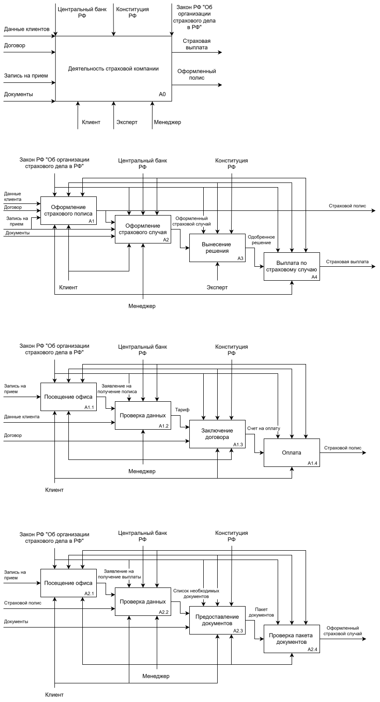
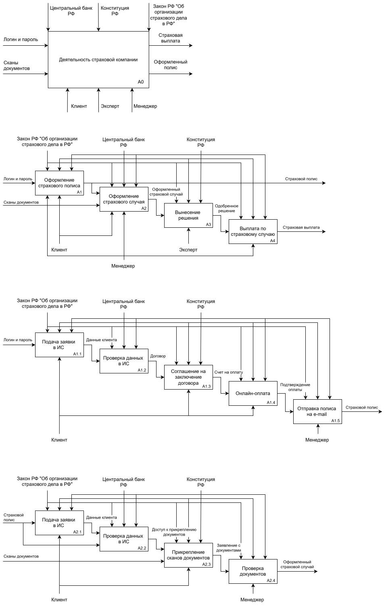
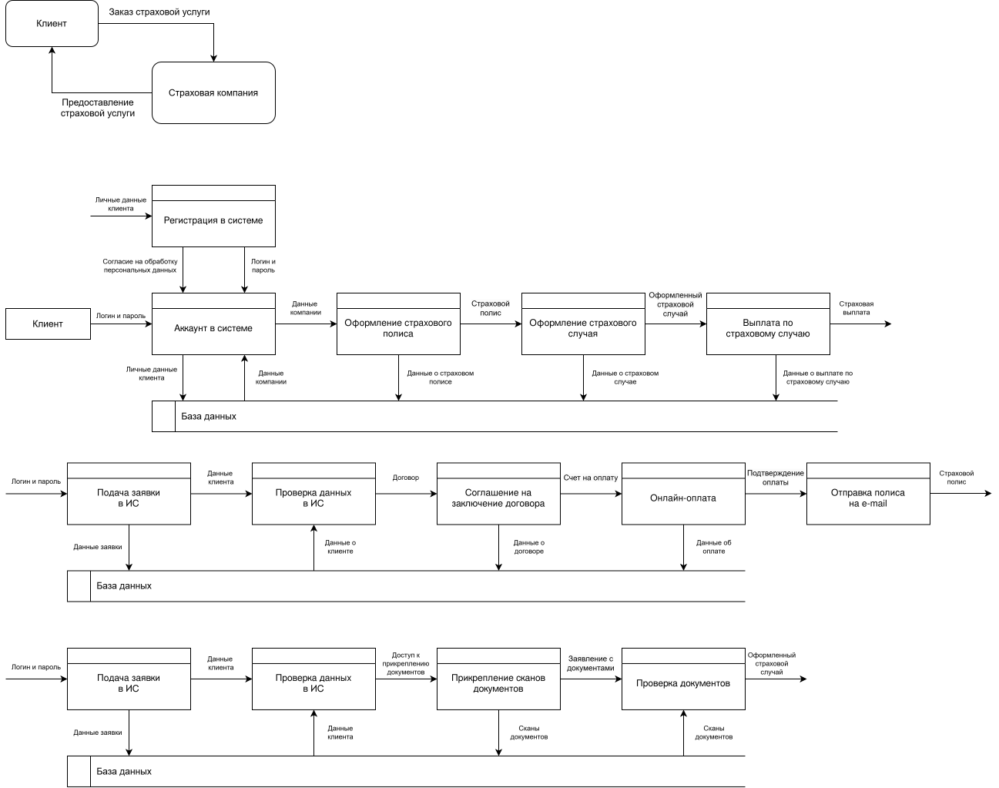

# Проектирование и моделирование бизнес-процессов страховой компании

В данном кейсе представлены анализ и моделирование бизнес-процессов страховой компании. Проектирование выполнено с использованием методологии функционального моделирования IDEF0.

Объект проектирования – деятельность страховой компании. 

## Построение диаграммы AS-IS 

Деятельность страховой компании без использование проектируемой информационной системы.

$`\color{yellow}*`$ **Входные документы:** данные клиентов, договор, запись на прием, документы; 
$`\color{yellow}*`$ **Управляющие регламенты:** центральный банк РФ, конституция РФ, закон РФ "Об организации страхового дела в РФ"; 
$`\color{yellow}*`$ **Исполнители:** клиент, эксперт, менеджер; 
$`\color{yellow}*`$ **Выходные документы:** страховая выплата, оформленный полис. 

## Построение диаграммы TO-BE 

В рамках диаграммы TO-BE была спроектирована логика работы информационной системы страховой компании.

$`\color{yellow}*`$ **Входные документы:** логин и пароль, сканы документов; 
$`\color{yellow}*`$ **Управляющие регламенты:** центральный банк РФ, конституция РФ, закон РФ "Об организации страхового дела в РФ"; 
$`\color{yellow}*`$ **Исполнители:** клиент, эксперт, менеджер; 
$`\color{yellow}*`$ **Выходные документы:** страховая выплата, оформленный полис. 

## Построение диаграммы DFD

Единое информационное пространство. 

