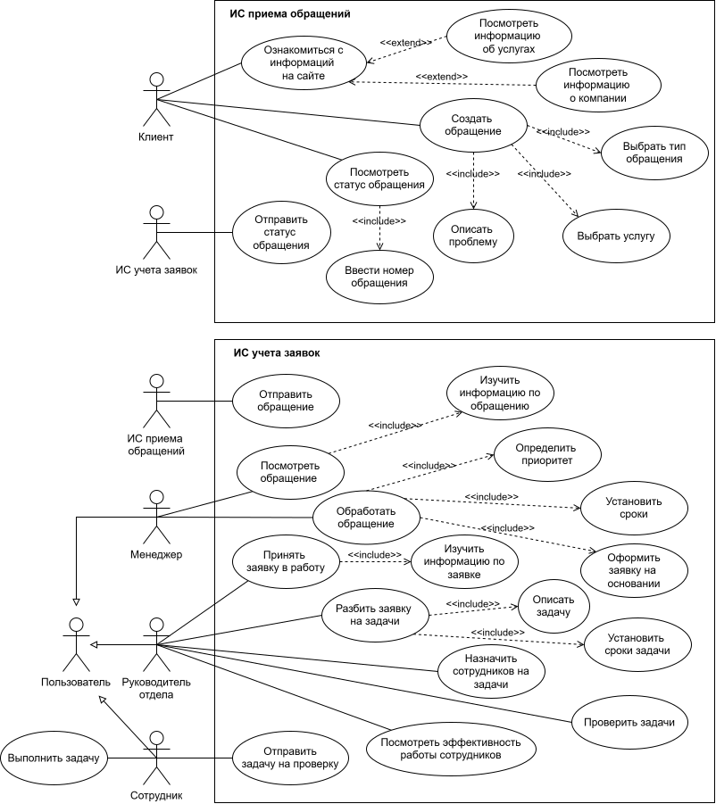
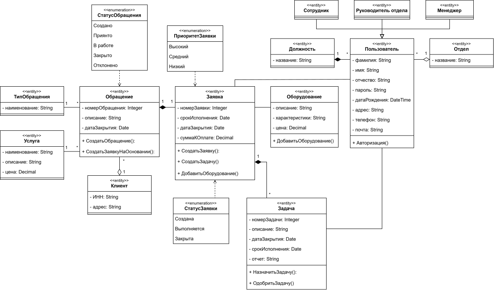
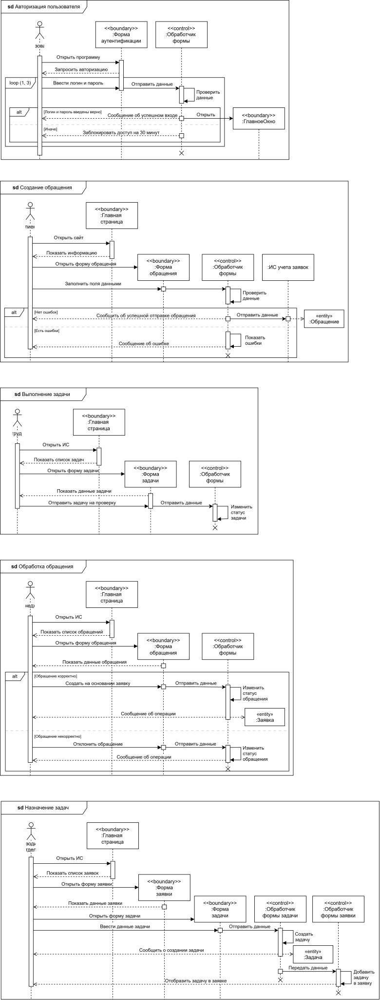
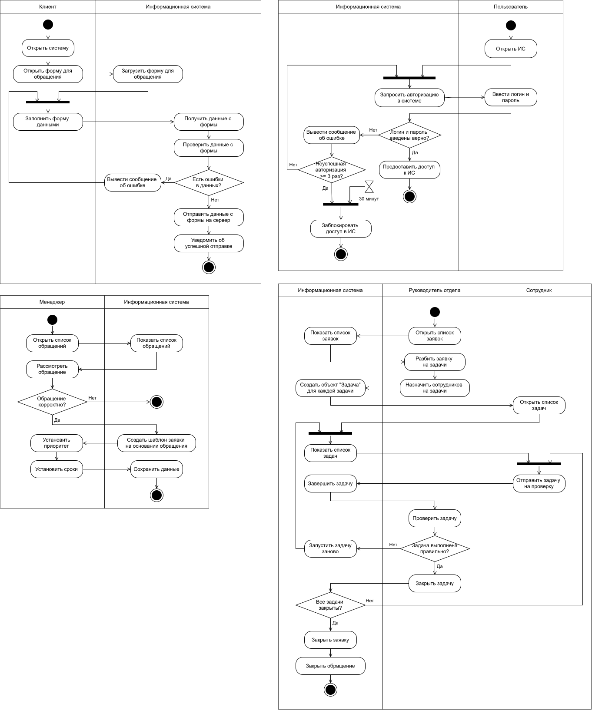
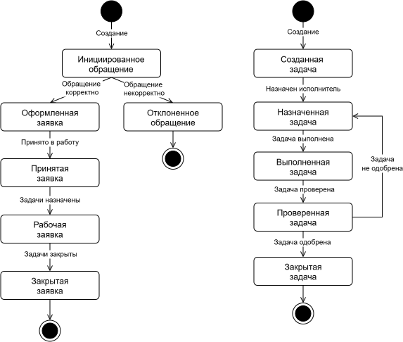

# Проектирование информационной системы для IT-компании

В данном кейсе представлены анализ и моделирование бизнес-процессов IT-компании. 
Проектирование выполнено с использованием следующих **методологий** и **нотаций**:

$`\color{yellow}*`$ `BPMN` 
$`\color{yellow}*`$ `UML` 

**Объект проектирования** – деятельность IT-компании. Это организация, деятельность которой сосредоточена в области информационных технологий. Такая компания предоставляет широкий спектр услуг, который может включать в себя разработку, внедрение и обслуживание программного обеспечения, управление сетями и обеспечение информационной безопасности.

## Разработка концептуальной модели

Концептуальная модель – это описание предметной области, которое построено в процессе ее анализа и выполнено с использованием естественного языка, математических выражений, таблиц, графов и других средств.

### Диаграмма AS-IS 

Это модель для описания бизнес-процессов в организации, с помощью которой отражается и визуализируется, как организованы процессы в данный момент, без использования информационной системы.

На изображении представлен процесс "Учет обращений в IT-компании".

   
  <em>Процесс "Учет обращений в IT-компании"</em>

На изображении представлен подпроцесс "Обработать обращение".

   
  <em>Подроцесс "Обработать обращение"</em>

На изображении представлен подпроцесс "Выполнить задачу".

   
  <em>Подроцесс "Выполнить задачу"</em>

### Диаграмма TO-BE 

Это модель для описания бизнес-процессов в организации, с помощью которой отражается и визуализируется, как будут организованы процессы в будущем, после создания и внедрения информационной системы.

На изображении представлен процесс "Учет обращений в IT-компании". Цветом выделены подпроцессы и задачи, которые претерпели изменение после их автоматизации. Процесс "Оценка качества работы сотрудников" теперь осуществляется информационной системой.

   
  <em>Процесс "Учет обращений в IT-компании"</em>

На изображении представлен подпроцесс "Обработать обращение".

   
  <em>Подроцесс "Обработать обращение"</em>

## Разработка логической модели

Логическая модель информационной системы – это совокупность описания ее объектов и связей между ними.

### Диаграмма прецедентов

Данная диаграмма позволяет описать функциональные возможности системы и показать, какие действия могут выполнять пользователи и какие результаты они могут получать.

Клиент компании через веб-приложение может подать обращение и следить за его статусом с помощью специального функционала. Конфигурация 1С по запросу будет отправлять данные о статусе обращения Клиенту. Веб-приложение будет пересылать данные обращения Клиента в конфигурацию 1С. Менеджер обрабатывает и классифицирует обращения и создании заявки на его основании. Руководитель отдела принимает заявку в работу и разбивает ее на отдельные задачи, назначаемые Сотрудникам. Сотрудник выполняет поставленные задачи Руководителем отдела и отчитывается перед ним о результатах работы.

### Диаграмма классов

Диаграмма классов базы данных используется для того, чтобы показать структуру данных, состоит из классов, их атрибутов, методов и связей между ними. Диаграмма классов интерфейса предназначена для того, чтобы показать структуру непосредственно самой системы. 

В процессе построения диаграммы классов было определено шестнадцать классов: Тип обращения, Услуга, Обращение, Клиент, Заявка, Задача, Оборудование, Должность, Отдел и Пользователь, от которого наследуются Менеджер, Руководитель отдела, Сотрудник, Статус обращения, Приоритет заявки и Статус заявки.

### Диаграмма последовательности

Данная диаграмма отражает, как объекты взаимодействуют друг с другом в рамках определенного сценария или прецедента.

Диаграммы последовательности были построены для каждого актера (не являющегося информационной системой) из диаграммы прецедентов.

### Диаграмма деятельности

Данная диаграмма позволяет наглядно представить последовательность действий, необходимых для выполнения бизнес-процессов.

Диаграммы деятельности были построены на основе диаграмм последовательности.

### Диаграмма состояний

Данная диаграмма визуализирует поведение объекта в течение его жизненного цикла, показывая состояния, в которых он может находиться, и переходы между ними, вызванные событиями.

Диаграмма состояний помогает понять, как обращение и задача меняют свое поведение с течением времени.
