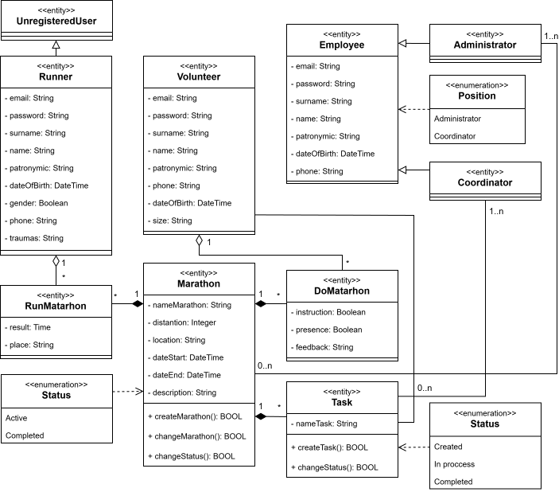
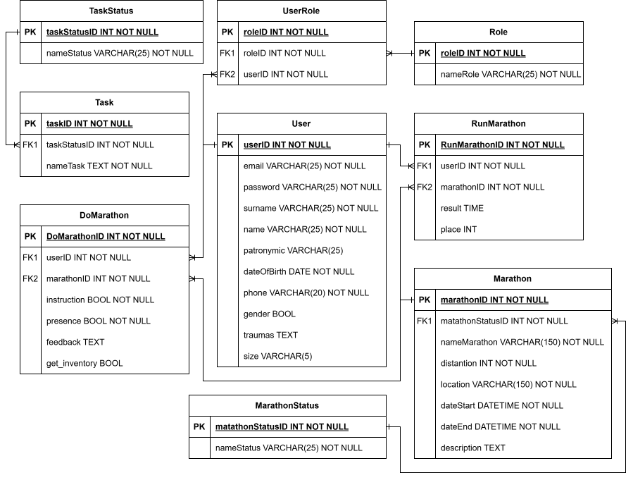

# Проектирование информационной системы для реализации марафона

В данном кейсе представлены анализ и моделирование бизнес-процессов реализации марафона. 
Проектирование выполнено с использованием следующих **методологий** и **нотаций**:

$`\color{yellow}*`$ `BPMN` 
$`\color{yellow}*`$ `UML` 
$`\color{yellow}*`$ `IDEF1X` 

**Объект проектирования** – организация и проведение марафона.

## Разработка концептуальной модели

Концептуальная модель – это описание предметной области, которое построено в процессе ее анализа и выполнено с использованием естественного языка, математических выражений, таблиц, графов и других средств.

### Диаграмма AS-IS 

Это модель для описания бизнес-процессов в организации, с помощью которой отражается и визуализируется, как организованы процессы в данный момент, без использования информационной системы.

На изображении представлен процесс “Реализация марафона”.

.png)

На изображении представлен подпроцесс “Организует марафон”.

.png)

На изображении представлен подпроцесс “Регистрирует бегунов”.

.png)

На изображении представлен подпроцесс “Реализует проведение”.

.png)

На изображении представлен подпроцесс “Управляет и контролирует”.

.png)

На изображении представлен подпроцесс “Помогает в проведении”.

.png)

На изображении представлен подпроцесс “Фиксирует результаты”.

.png)

### Диаграмма TO-BE 

Это модель для описания бизнес-процессов в организации, с помощью которой отражается и визуализируется, как будут организованы процессы в будущем, после создания и внедрения информационной системы.

На изображении представлен процесс “Реализация марафона”. Синим цветом выделены подпроцессы и задачи, которые не были подвергнуты изменениям после анализа модели “AS-IS”. Данные процессы не требовали автоматизации, поэтому также не были декомпозированы повторно. Подпроцессы, подвергшиеся автоматизации были декомпозированы для более детального анализа изменений после внедрения информационной системы.

.png)

На изображении представлен подпроцесс “Создает марафон в системе”.

.png)

На изображении представлен подпроцесс “Реализует проведение”.

.png)

На изображении представлен подпроцесс “Управляет и контролирует”.

.png)

На изображении представлен подпроцесс “Помогает в проведении”.

.png)

На изображении представлен подпроцесс “Регистрируется в роли бегуна/волонтера”.

.png)

## Разработка логической модели

Логическая модель информационной системы – это совокупность описания ее объектов и связей между ними.

### Диаграмма прецедентов

Данная диаграмма позволяет описать функциональные возможности системы и показать, какие действия могут выполнять пользователи и какие результаты они могут получать.

Пользователь может зарегистрироваться на активный марафон. Координатор может создавать новые задания для волонтеров. Администратор может создать марафон в системе, редактировать информацию о нем. Волонтер может регистрировать новых бегунов на активный марафон и выполнять добавленные координатором задания.

### Диаграмма классов

Диаграмма классов базы данных используется для того, чтобы показать структуру данных, состоит из классов, их атрибутов, методов и связей между ними. Диаграмма классов интерфейса предназначена для того, чтобы показать структуру непосредственно самой системы. 

В процессе построения диаграммы классов было определено шестнадцать классов: Тип обращения, Услуга, Обращение, Клиент, Заявка, Задача, Оборудование, Должность, Отдел и Пользователь, от которого наследуются Менеджер, Руководитель отдела, Сотрудник, Статус обращения, Приоритет заявки и Статус заявки.

### Диаграмма последовательности

Данная диаграмма отражает, как объекты взаимодействуют друг с другом в рамках определенного сценария или прецедента.

Диаграммы последовательности были построены для каждого актера из диаграммы прецедентов.

## Разработка логической модели данных

Логическая модель данных – это абстрактное представление структуры данных.

