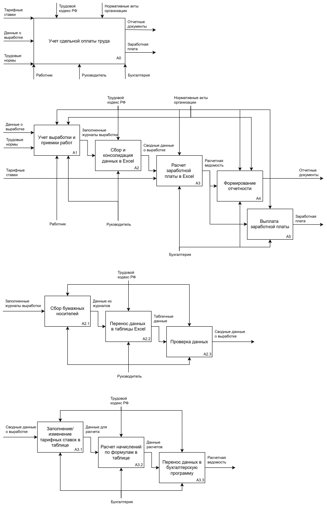
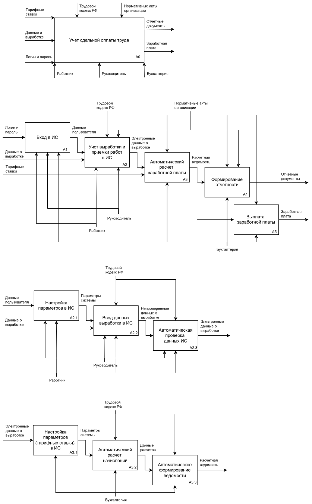
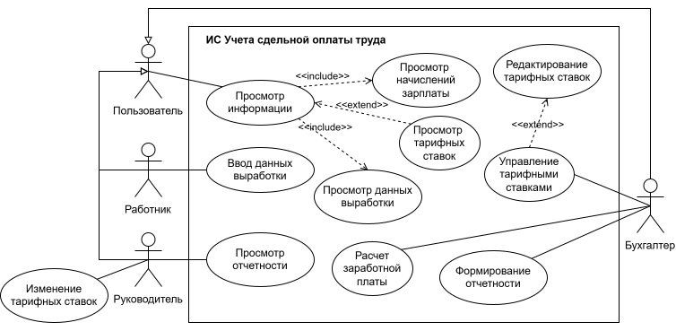
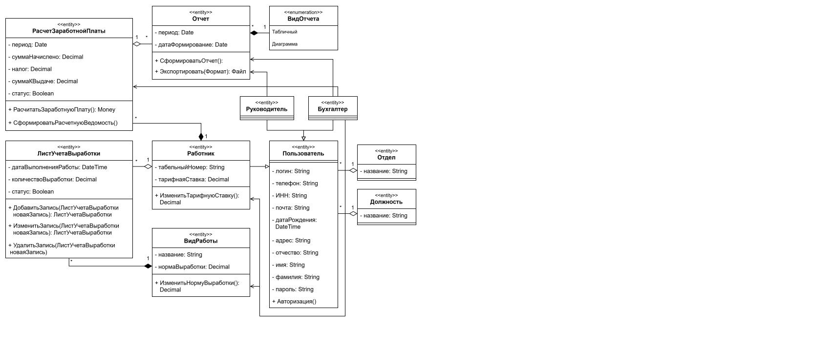
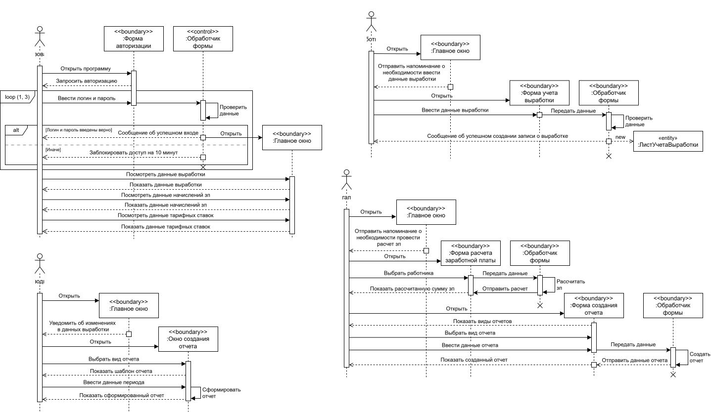
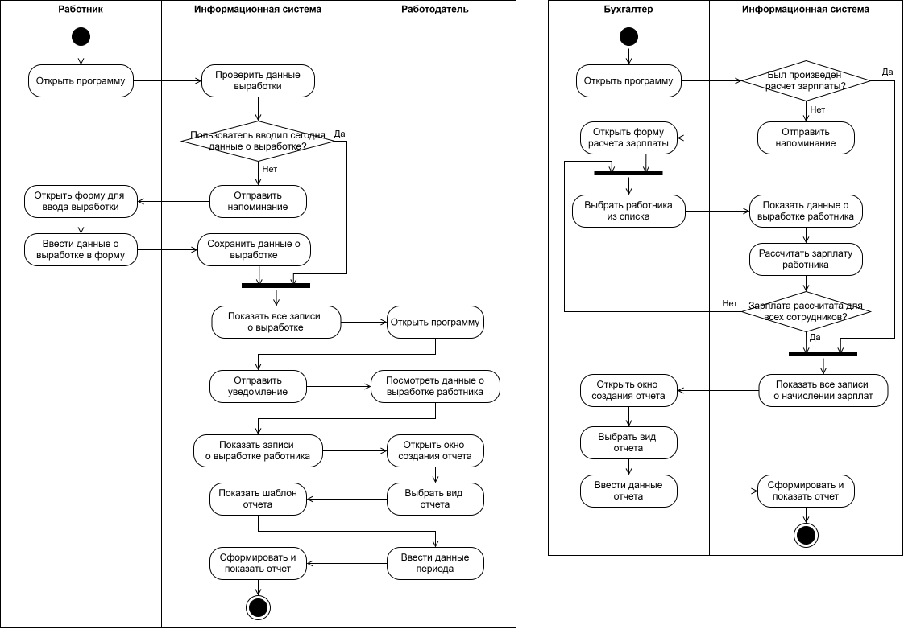
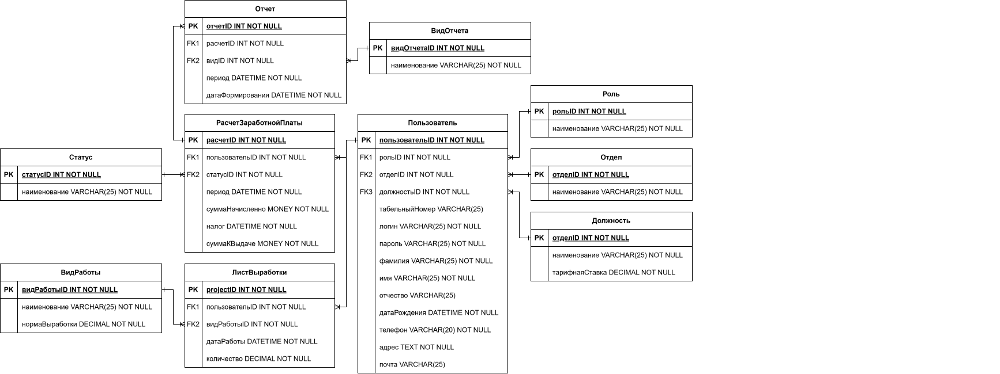

# Проектирование информационной системы для учета сдельной оплаты труда

В данном кейсе учет сдельной оплаты труда рассмотрен с точки зрения компании по разработке программного обеспечения.
Проектирование выполнено с использованием следующих **методологий** и **нотаций**:

$`\color{yellow}*`$ `IDEF0` · `IDEF1X` 
$`\color{yellow}*`$ `DFD` 
$`\color{yellow}*`$ `UML` 

**Объект проектирования** – учет сдельной оплаты труда. Это расчет заработной платы сотрудников, чей доход напрямую зависит от количества и качества произведенной продукции или выполненных операций.

## Разработка концептуальной модели

Концептуальная модель – это описание предметной области, которое построено в процессе ее анализа и выполнено с использованием естественного языка, математических выражений, таблиц, графов и других средств.

### Диаграмма AS-IS 

Это модель для описания бизнес-процессов в организации, с помощью которой отражается и визуализируется, как организованы процессы в данный момент, без использования информационной системы.

**Структура диаграммы:**

$`\color{yellow}*`$ **Входные документы:** данные о выработке, трудовые нормы и тарифные ставки; 
$`\color{yellow}*`$ **Выходные документы:** отчетная документация, заработная плата; 
$`\color{yellow}*`$ **Управляющие регламенты:** трудовой кодекс Российской Федерации и нормативные акты компании; 
$`\color{yellow}*`$ **Исполнители:** работник, руководитель и бухгалтерия. 

В декомпозиции нулевого уровня процесса "Учет сдельной оплаты труда" можно увидеть, что процессы "Учет выработки и приемки работ" и "Сбор и консолидация данных в Excel" не автоматизированы, то есть выполняются вручную работниками компании. Вследствие этого, они чаще всего подвержены ошибкам и неточностям, а также занимают много времени на выполнение.

Для того, чтобы рассчитать заработную плату необходимо сначала собрать все бумажные журналы, в которых сотрудники фиксируют данные о выработке, а после перенести их в электронные таблицы. Расчет заработной платы автоматизирован с помощью формул в электронных таблицах, но все еще требует рутинных действий по переносу этих данных в учетную бухгалтерскую систему.

### Диаграмма TO-BE 

Это модель для описания бизнес-процессов в организации, с помощью которой отражается и визуализируется, как будут организованы процессы в будущем, после создания и внедрения информационной системы.

**Структура диаграммы:**

$`\color{yellow}*`$ **Входные документы:** логин и пароль, данные о выработке, трудовые нормы и тарифные ставки; 
$`\color{yellow}*`$ **Выходные документы:** отчетная документация, заработная плата; 
$`\color{yellow}*`$ **Управляющие регламенты:** трудовой кодекс Российской Федерации и нормативные акты компании; 
$`\color{yellow}*`$ **Исполнители:** работник, руководитель и бухгалтерия. 

В декомпозиции нулевого уровня процесса "Учет сдельной оплаты труда" можно увидеть, что процесса "Сбор и консолидация данных в Excel" больше нет на схеме. В декомпозиции процесса "Учет выработки и приемки работ в ИС" можно увидеть, что теперь все данные фиксируются в информационной системе, а не на бумажных носителях. В декомпозиции процесса "Автоматический расчет заработной платы" можно увидеть, что теперь расчет заработной платы осуществляется системой на основании параметров (тарифные ставки и нормы выработки), которые бухгалтер может изменить (в соответствии с документами).

## Разработка логической модели

Логическая модель информационной системы – это совокупность описания ее объектов и связей между ними.

### Диаграмма прецедентов

Данная диаграмма позволяет описать функциональные возможности системы и показать, какие действия могут выполнять пользователи и какие результаты они могут получать.

Пользователь может просматривать данные выработки, информацию о тарифных ставках и начисления заработной платы. Работник, руководитель и бухгалтер наследуются от пользователя, поэтому им доступны те же действия. Работник может вводить данные выработки, руководитель – просматривать отчетные документы, а бухгалтер – управлять тарифными ставками, рассчитывать заработную плату и формировать отчеты.

### Диаграмма классов

Диаграмма классов базы данных используется для того, чтобы показать структуру данных, состоит из классов, их атрибутов, методов и связей между ними. Диаграмма классов интерфейса предназначена для того, чтобы показать структуру непосредственно самой системы. 

Базовый класс "Пользователь" описывает персональные и контактные данные человека, такие как ФИО, паспортные данные, ИНН, адрес, а также метод авторизации для доступа в систему. Для учета рабочей деятельности определен класс "Лист учета выработки", хранящий данные о дате, объеме выполненной работы и статусе операции, а также предоставляющий методы для управления записями. Класс ""Вид работы" содержит данные о норме выработки, а класс "Работник" – данные тарифной ставки. Благодаря этим двум критериям рассчитывается заработная плата работника. Класс "Расчет заработной платы" содержит атрибуты, описывающие финансовый период, промежуточные суммы (начислено, налог) и итоговую сумму к выдаче, а также методы для непосредственного вычисления зарплаты и формирования ведомости. Класс "Отчет" отвечает за документооборот и включает период, дату формирования, а также методы для создания и экспорта отчетных документов в различные форматы.

### Диаграмма последовательности

Данная диаграмма отражает, как объекты взаимодействуют друг с другом в рамках определенного сценария или прецедента.

После успешной авторизации пользователь попадает на главное окно программы, где может посмотреть данные выработки, данные о заработной плате и свои тарифные ставки. При неуспешной авторизации более трех раз пользователю будет заблокирован доступ в информационную систему на десять минут.

Работнику после входа каждый день приходит уведомление о необходимости ввести данные о выработке, если он этого еще не сделал. Для этого он из главного окна открывает форму учета выработки. После ввода форма передает данные обработчику формы для дальнейшей валидации и обработки. После успешной проверки обработчик инициирует создание нового экземпляра сущности "Лист учета выработки", что соответствует сохранению записи в базе данных. После успешного создания записи система формирует сообщение, которое отображается работнику, подтверждая завершение операции.

Руководителю приходит уведомление о внесенных записях выработки от работников, которые он может посмотреть и проверить. Процесс начинается с открытия руководителем главного окна программы. Предварительное событие "Уведомить об изменениях в данных выработки" указывает на то, что система сама инициирует данный процесс. 

Также руководителю доступны все созданные бухгалтерий отчеты. Для этого он выбирает вид отчета и вводит период, за который ему необходимо построить отчет.
Бухгалтеру 2 раза в месяц приходит уведомление о необходимости провести расчет заработной платы, который он осуществляет в специальной форме по каждому сотруднику компании. Бухгалтер открывает форму расчета заработной платы, где сначала выбирает работника из списка, а затем период для расчета. Расчет заработной платы выполняет система. Также бухгалтер ответственен за создание отчетной документации. Он выбирает вид отчета, вводит необходимые данные и запускает команду создания отчета.

### Диаграмма деятельности

Данная диаграмма позволяет наглядно представить последовательность действий, необходимых для выполнения бизнес-процессов.

Для бухгалтера процесс начинается с открытия программы. Если расчет заработной платы уже был выполнен, то система покажет все записи о начислении, если еще нет, то запускается основной процесс расчета. Если расчет не выполнен, система отправляет напоминание. Тогда бухгалтер открывает форму, выбирает сотрудника из списка, и система отображает для него данные выработки. Затем бухгалтер инициирует расчет зарплаты работника.

После расчета для одного сотрудника следует условие: рассчитана ли зарплата рассчитана всех сотрудников. Это цикл, который заставляет бухгалтера возвращаться к выбору следующего работника из списка, пока не будет обработан весь штат. Для создания отчета бухгалтер открывает специальное окно, выбирает вид отчета, вводит его параметры и дает команду на формирование.

Работник начинает с открытия программы и получения напоминания от системы, если в текущий день он не вводил данные о выработке. Далее он может ввести данные о выработке, которые после будут сохранены системой в базу данных для расчета заработной платы.

Работодателю, когда он открывает программу, приходит уведомление, если работник из его отдела ввел данные о выработке. Он может посмотреть эти данные и проверить. Также в системе работодатель может формировать созданные бухгалтерией отчеты. Для создания отчета работодатель открывает специальное окно, выбирает вид отчета, вводит период, и система в ответ формирует и показывает отчет.

## Разработка логической модели данных

Логическая модель данных – это абстрактное представление структуры данных.

При разработке ER-модели были выделены следующие сущности: роль, должность, отдел, пользователь, расчет заработной платы, лиск выработки, вид работы, статус, отчет и вид отчета.
