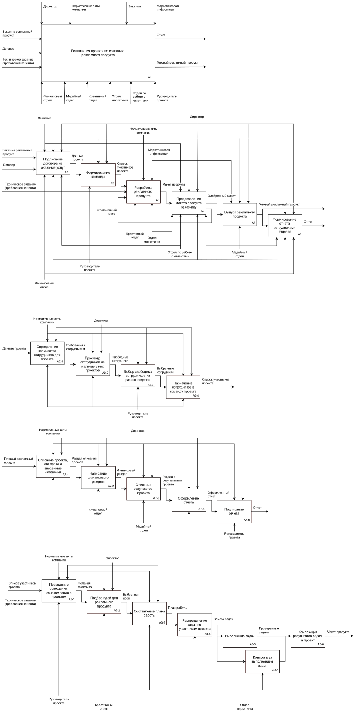
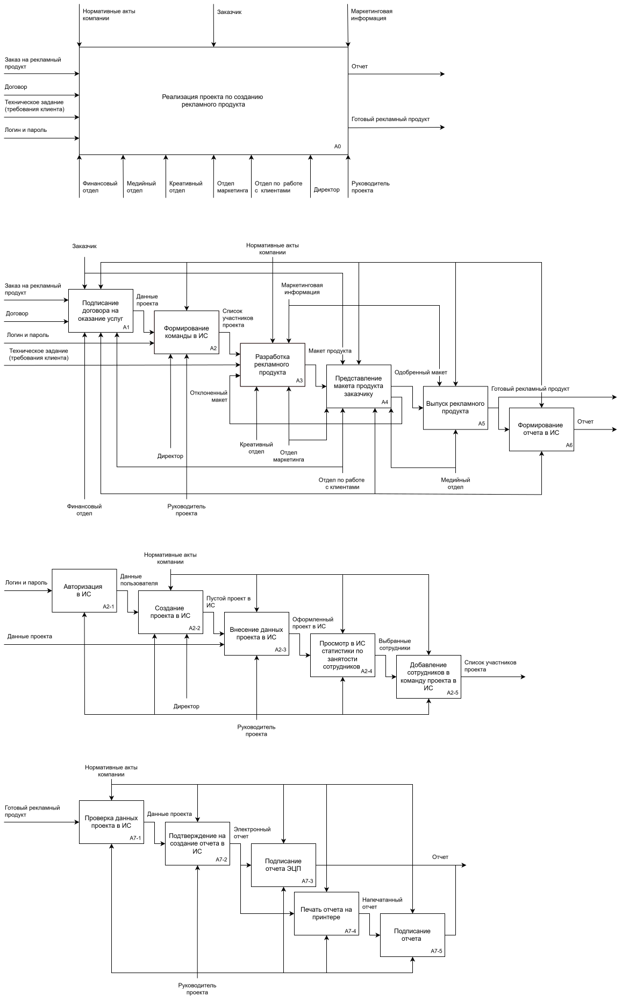
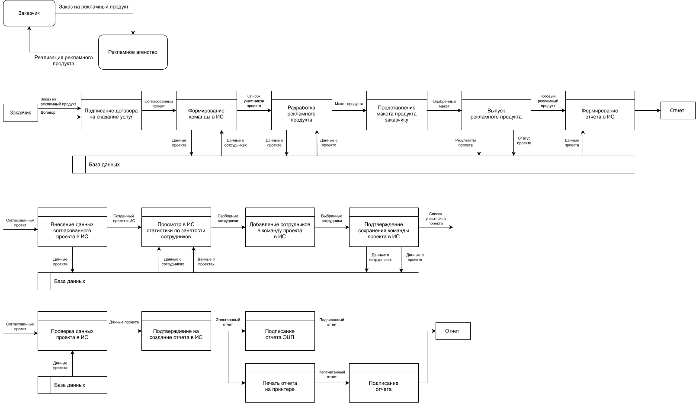
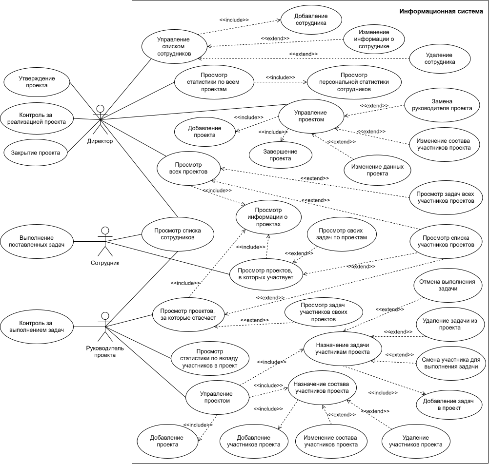
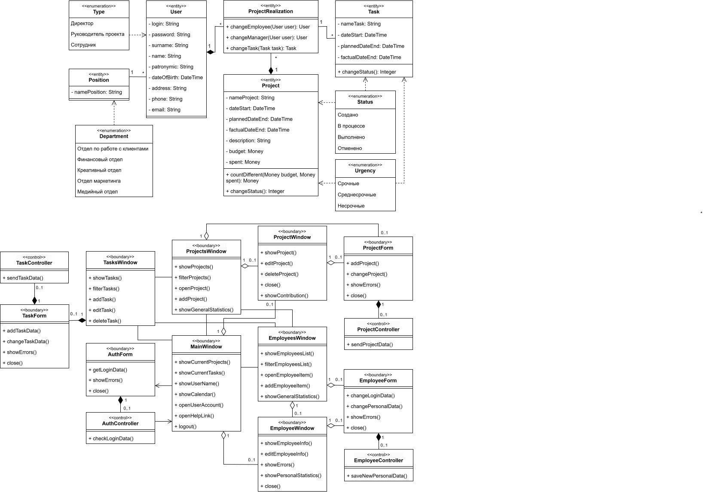
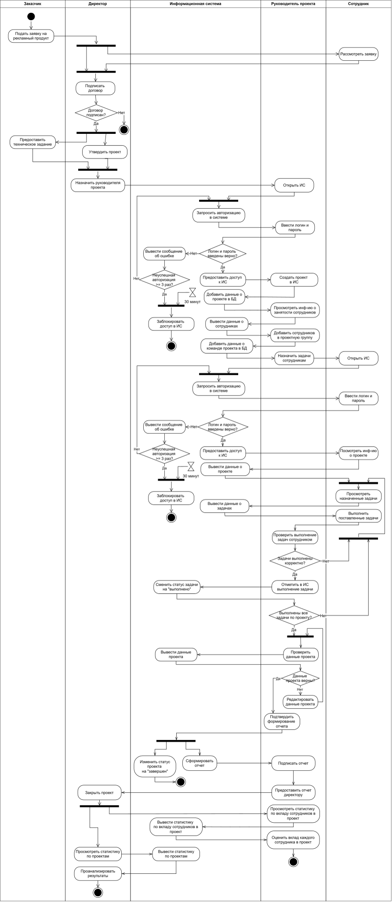
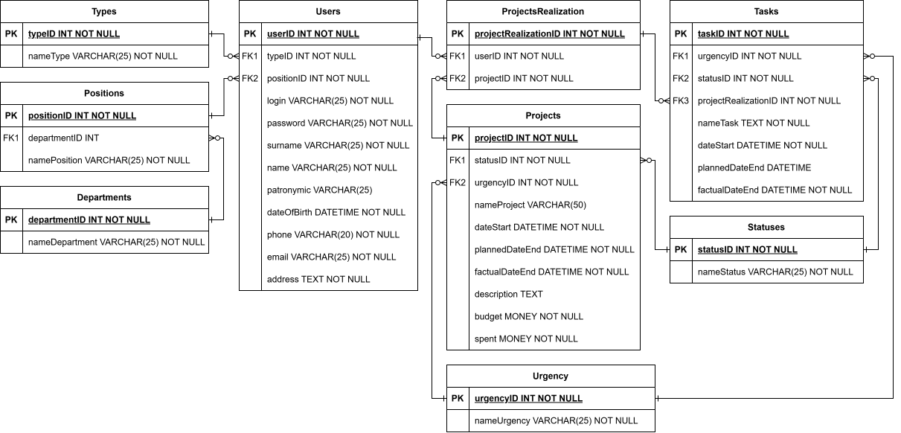

# Проектирование информационной системы для рекламного агентства

В данном кейсе представлены анализ и моделирование бизнес-процессов рекламного агентства. 
Проектирование выполнено с использованием следующих **методологий** и **нотаций**:

$`\color{yellow}*`$ `IDEF0` 
$`\color{yellow}*`$ `IDEF1X` 
$`\color{yellow}*`$ `DFD` 
$`\color{yellow}*`$ `UML` 

**Объект проектирования** – деятельность рекламного агентства. Это организация, которая специализируется на разработке, подготовке, производстве и размещении рекламного продукта. 

## Разработка концептуальной модели

Концептуальная модель – это описание предметной области, которое построено в процессе ее анализа и выполнено с использованием естественного языка, математических выражений, таблиц, графов и других средств.

### Диаграмма AS-IS 

Это модель для описания бизнес-процессов в организации, с помощью которой отражается и визуализируется, как организованы процессы в данный момент, без использования информационной системы.

**Структура диаграммы:**

$`\color{yellow}*`$ **Входные документы:** заявка, договор и техническое задание; 
$`\color{yellow}*`$ **Выходные документы:** отчет по проекту, готовый рекламный продукт; 
$`\color{yellow}*`$ **Управляющие регламенты:** директор агентства, заказчик, нормативные акты компании и маркетинговая информация; 
$`\color{yellow}*`$ **Исполнители:** отделы рекламного агентства, руководитель проекта. 

В декомпозиции процесса реализации проекта по созданию рекламного продукта (рисунок 2) можно увидеть, что процессы формирования команды для проекта и формирование отчета относительно нетрудоемкие, но занимают достаточно много времени, которое можно было потратить непосредственно на разработку продукта.

Процесс формирования команды ложится на плечи руководителя проекта. Он должен вручную проверить всех сотрудников из всех отделов на наличие у них проектов и отобрать в команду тех, кто свободен и может участвовать в текущем проекте, а также имеет достаточную квалификацию для этого. Далее он также вручную ведет записи о новом проекте, что занимает много времени и ресурсов, которые можно было бы использовать более эффективно.

Процесс формирования отчета осуществляется сотрудниками медийного и финансового отделов, а после его оформления подписывается у руководителя проекта. 

Сотрудники медийного отдела составляют описание проекта, записывают сроки его выполнения и внесенные в процессе его разработки изменения, а также оформляют отчет в соответствии с нормативными актами компании. Сотрудники финансового отдела оформляют финансовую часть проекта. Руководитель контролирует работу этих отделов и после окончательного оформления отчета подписывает его и сдает директору рекламного агентства.

### Диаграмма TO-BE 

Это модель для описания бизнес-процессов в организации, с помощью которой отражается и визуализируется, как будут организованы процессы в будущем, после создания и внедрения информационной системы.

**Структура диаграммы:**

$`\color{yellow}*`$ **Входные документы:** логин и пароль, заявка, договор и техническое задание; 
$`\color{yellow}*`$ **Выходные документы:** отчет по проекту, готовый рекламный продукт; 
$`\color{yellow}*`$ **Управляющие регламенты:** заказчик, нормативные акты компании и маркетинговая информация; 
$`\color{yellow}*`$ **Исполнители:** директор, отделы рекламного агентства, руководитель проекта. 

В декомпозиции процесса реализации проекта по созданию рекламного продукта можно наглядно увидеть, что существенные изменения произошли на седьмом шаге процесса – формировании отчета. Теперь отчет полностью формируется в информационной системе без участия в этом процессе сотрудников медийного и финансового отделов.

Также директор рекламного агентства теперь является механизмом, а не управляющим элементом. С появлением информационной системы он сможет принимать непосредственное участие в бизнес-процессах организации.

Наряду с этим и процесс формирования команды был подвержен автоматизации. Теперь руководитель может видеть и анализировать занятость всех сотрудников в режиме реального времени и добавлять выбранных сотрудников в команду своего проекта. После авторизации руководитель вносит данные согласованного проекта в информационную систему, и тогда он уже может приступать к набору сотрудников в команду.

Процесс формирования отчета больше не зависит от сотрудников медийного и финансового отделов. Руководитель проверяет данные проекта, по которому ему необходимо составить отчет, и, если ошибок нет, то он подтверждает формирование отчета. Информационная система берет данные проекта из базы данных и сама формирует отчет в электронном виде. Далее, после того, как система сформирует отчет, руководитель может подписать его с помощью ЭЦП и сохранить в электронном варианте или распечатать его и подписать вручную.

### Диаграмма DFD

Данная диаграмма показывает, как информация попадает в систему, где обрабатывается, где хранится и куда уходит дальше. 

## Разработка логической модели

Логическая модель информационной системы – это совокупность описания ее объектов и связей между ними.

### Диаграмма прецедентов

Данная диаграмма позволяет описать функциональные возможности системы и показать, какие действия могут выполнять пользователи и какие результаты они могут получать.

В процессе построения диаграммы прецедентов были определены три актера (типа пользователей), которые будут взаимодействовать с проектируемой информационной системой.

**Первый актер** – это директор организации. Он отвечает за утверждение проекта и его последующее завершение. Директор может изменять состав проектной группы, в том числе и руководителя проекта; добавлять, изменять и завершать проект; просматривать в системе информацию и статистику по всем проектам и сотрудникам организации.

**Второй актер** – это руководитель проекта. Он ответственен за работу проектной группы. В системе он может добавлять проект и его данные; назначать сотрудников в проектную группу и в последующем изменять ее состав; смотреть, добавлять, изменять, отменять и удалять задачи участникам проекта; смотреть статистику по вкладу участников в проект.

**Третий актер** – это сотрудник организации. Он отвечает за работу в проектных группах. В системе он может смотреть информацию подробную о своих проектах и краткую о других, об участниках своих проектов и задачи, которые ему назначил руководитель проекта.

### Диаграмма классов

Диаграмма классов базы данных используется для того, чтобы показать структуру данных, состоит из классов, их атрибутов, методов и связей между ними. Диаграмма классов интерфейса предназначена для того, чтобы показать структуру непосредственно самой системы. 

В процессе построения диаграммы классов базы данных было определено девять классов. Классы *User* и *Project* связаны с классом *ProjectRealization* отношением композиции, потому что реализация проекта невозможна без существования самого проекта и тех, кто собственно будет его реализовывать. Кратность этой связи показывает, что один пользователь и один проект могут иметь несколько реализаций. Одна и та же должность может относиться к нескольким пользователям, поэтому кратность связи между классами *User* и *Position* – один ко многим. Одна реализация проекта может иметь несколько задач с одним и тем же сотрудником, который ее выполняет, и относиться к одному и тому же проекту.

В проектируемой системе будет пять основных окон: окно авторизации, главное окно программы, окно с проектами, окно со списком задач и окно со списком сотрудников. Перед тем, как начать пользоваться программой необходимо пройти авторизацию, поэтому окно с формой авторизации будет самым первым, что увидит пользователь при запуске программы. После успешной авторизации он попадает на главное окно.

На главном окне будет отображена информация о текущих проектах, задачах пользователя (если тип пользователя – сотрудник); календарь с отмеченными датами проектов или задач; а также ссылка на контакты разработчика и кнопка выхода из системы. 

В окне проектов будут отображены все проекты организации с возможностью их фильтрации и отображения информации о выбранном проекте в окне ProjectWindow. Для сотрудника будут доступны для подробного просмотра только те проекты, в которых он принимает непосредственное участие. Для руководителя проекта – те, за которые он отвечает.

В окне списка сотрудников будут отображены все сотрудники организации, с возможностью их фильтрации и отображения информации о выбранном сотруднике в окне EmployeesWindow. Для директора будет доступна подробная информация о каждом сотруднике.

Для руководителей проекта и директора будут доступны расширенные возможности в этих окнах. Они смогут видеть вклад каждого участника в проект в окне ProjectWindow и индивидуальную статистику каждого сотрудника организации. Также директор сможет видеть общую статистику по всем проектам и сотрудникам организации.

### Диаграмма последовательности

Данная диаграмма отражает, как объекты взаимодействуют друг с другом в рамках определенного сценария или прецедента.

На диаграмме последовательности для рекламного агентства показана реализация проекта с точки зрения общего процесса для ознакомления с деятельностью данной организации. В этом случае актером выступает заказчик, который заключает с рекламным агентством договор об оказании услуг и контролирует процесс разработки, подготовки, производства и размещения рекламного продукта.

На диаграмме последовательности для сотрудника отображены действия, которые совершает сотрудник в информационной системе. При неуспешной авторизации более трех раз сотруднику будет заблокирован доступ в информационную систему на тридцать минут. В окне проектов сотрудник может видеть все проекты организации, но подробную информацию он может посмотреть только тех проектов, в которых он принимает участие. В окне задач сотрудник может видеть все свои задачи, распределенные по проектам.

На диаграмме последовательности для руководителя проекта отображены действия, которые он совершает в информационной системе. В окне проектов руководитель может видеть все проекты организации, но подробную информацию он может посмотреть только тех проектов, за которые он назначен ответственным. Также в этом окне руководитель может создавать проекты и вносить в них данные, выбирать сотрудников в проектные группы и видеть статистику вклада участников проектных групп в проект. В окне задач руководитель может видеть все задачи участников проектных групп, в которых он назначен руководителем. Он может назначать задачи по проектам участникам проектных групп и отмечать их выполненными.

На диаграмме последовательности для директора организации отображены действия, которые он совершает в информационной системе. В окне проектов директор может видеть все проекты организации, и просмотреть их подробную информацию. Также в этом окне директор может создавать проекты, вносить в них данные, изменять их данные, завершать проекты, видеть статистику вклада участников проектных групп в проект и общую статистику по всем проектам. В окне задач руководитель может видеть все задачи участников проектных групп, распределенные по проектам. В окне сотрудников руководитель может видеть список всех сотрудников, их подробную информацию, а также их персональную статистику по его проектам. Он может добавлять новых сотрудников в базу данных, изменять их информацию и удалять их.

### Диаграмма деятельности

Данная диаграмма позволяет наглядно представить последовательность действий, необходимых для выполнения бизнес-процессов.

Весь процесс начинается с заказчика, который должен подать заявку на создание рекламного продукта. Далее его заявка обрабатывается сотрудником, и уже директор организации подписывает договор с заказчиком. После подписания договора заказчик предоставляет техническое задание, и далее идет процесс реализации проекта по созданию рекламного продукта. Руководитель управляет этим процессом, в то время как сотрудники выполняют поставленные им задачи.

## Разработка логической модели данных

Логическая модель данных – это абстрактное представление структуры данных.

При разработке ER-модели было выделено шесть сущностей. Типы пользователей помогают разграничить права доступа к некоторым функциям информационной системы на основе положения в организации. *Departments*, *Positions*, *Statuses* и *Urgency* помогают избежать дублирования и избыточности данных, так как отделы и должности могут относиться к нескольким сотрудникам, а статусы и сроки выполнения – к нескольким проектам и задачам. Несколько сотрудников организации могут принимать участие в нескольких проектах, поэтому сущность *ProjectRealization* устраняет связь “многие-ко-многим” между сущностями *Projects* и *Users*.
