# Проектирование информационной системы для службы доставки

В данном кейсе представлены анализ и моделирование бизнес-процессов службы доставки. 
Проектирование выполнено с использованием следующих **методологий** и **нотаций**:

$`\color{yellow}*`$ `IDEF0` · `IDEF1X` 
$`\color{yellow}*`$ `DFD` 
$`\color{yellow}*`$ `UML` 

**Объект проектирования** – деятельность службы доставки.

## Разработка концептуальной модели

Концептуальная модель – это описание предметной области, которое построено в процессе ее анализа и выполнено с использованием естественного языка, математических выражений, таблиц, графов и других средств.

### Диаграмма AS-IS 

Это модель для описания бизнес-процессов в организации, с помощью которой отражается и визуализируется, как организованы процессы в данный момент, без использования информационной системы.

**Структура диаграммы:**

$`\color{yellow}*`$ **Входные документы:** накладная, бланк заказа, меню, ресторан, заказ, данные заказчика; 
$`\color{yellow}*`$ **Выходные документы:** отчет по курьерам, чек; 
$`\color{yellow}*`$ **Управляющие регламенты:** закон РФ "О защите прав потребителей", администратор, ГОСТ Р 71162-2023; 
$`\color{yellow}*`$ **Исполнители:** клиент, курьер. 

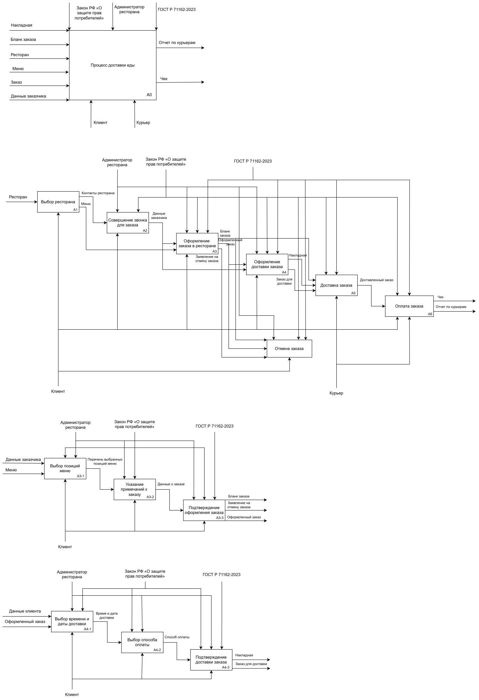

### Диаграмма TO-BE 

Это модель для описания бизнес-процессов в организации, с помощью которой отражается и визуализируется, как будут организованы процессы в будущем, после создания и внедрения информационной системы.

**Структура диаграммы:**

$`\color{yellow}*`$ **Входные документы:** накладная, бланк заказа, меню, ресторан, заказ, логин и пароль; 
$`\color{yellow}*`$ **Выходные документы:** отчет по курьерам, чек; 
$`\color{yellow}*`$ **Управляющие регламенты:** закон РФ "О защите прав потребителей", администратор, ГОСТ Р 71162-2023; 
$`\color{yellow}*`$ **Исполнители:** клиент, курьер. 

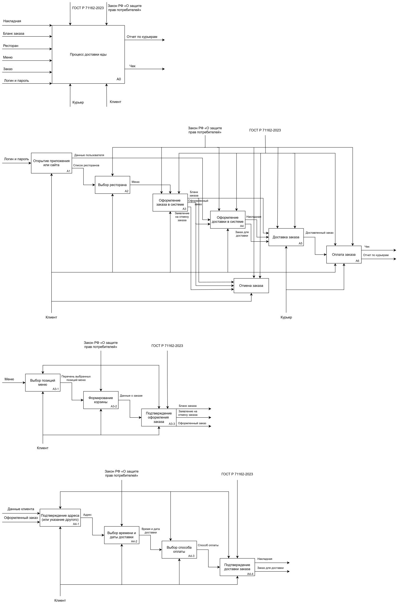

### Диаграмма DFD

Данная диаграмма показывает, как информация попадает в систему, где обрабатывается, где хранится и куда уходит дальше. 

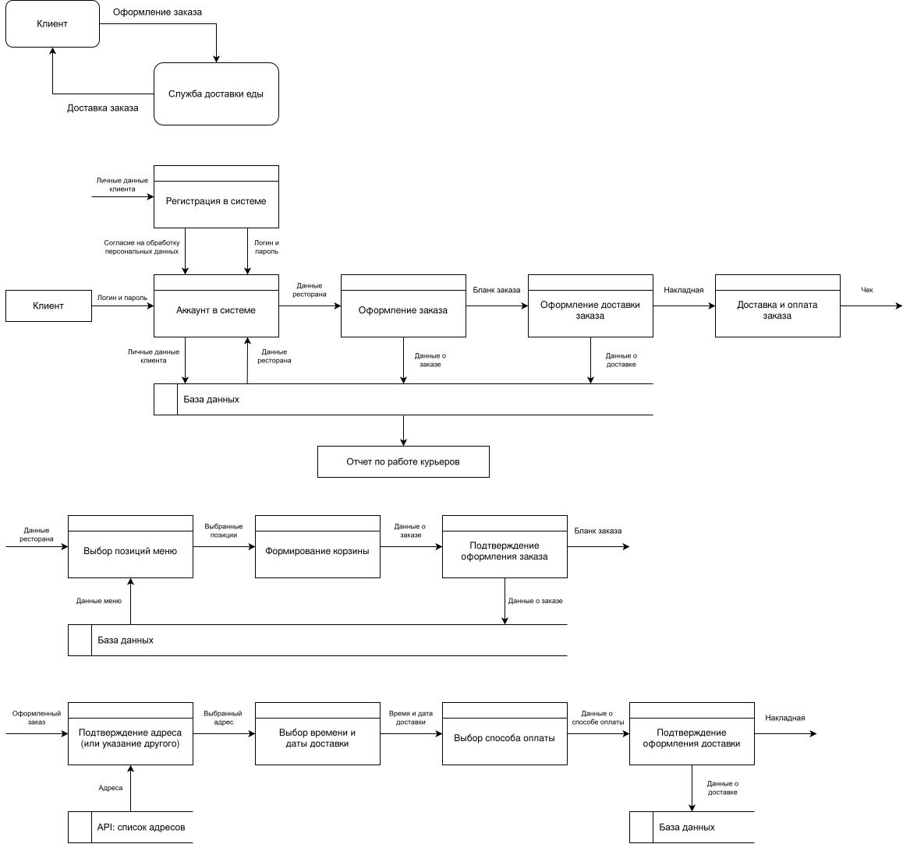

## Разработка логической модели

Логическая модель информационной системы – это совокупность описания ее объектов и связей между ними.

### Диаграмма прецедентов

Данная диаграмма позволяет описать функциональные возможности системы и показать, какие действия могут выполнять пользователи и какие результаты они могут получать.

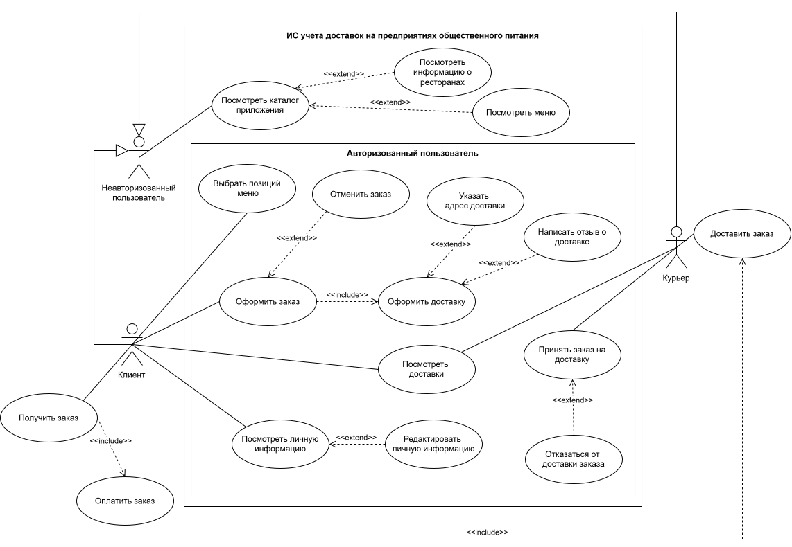

### Диаграмма классов

Диаграмма классов базы данных используется для того, чтобы показать структуру данных, состоит из классов, их атрибутов, методов и связей между ними.

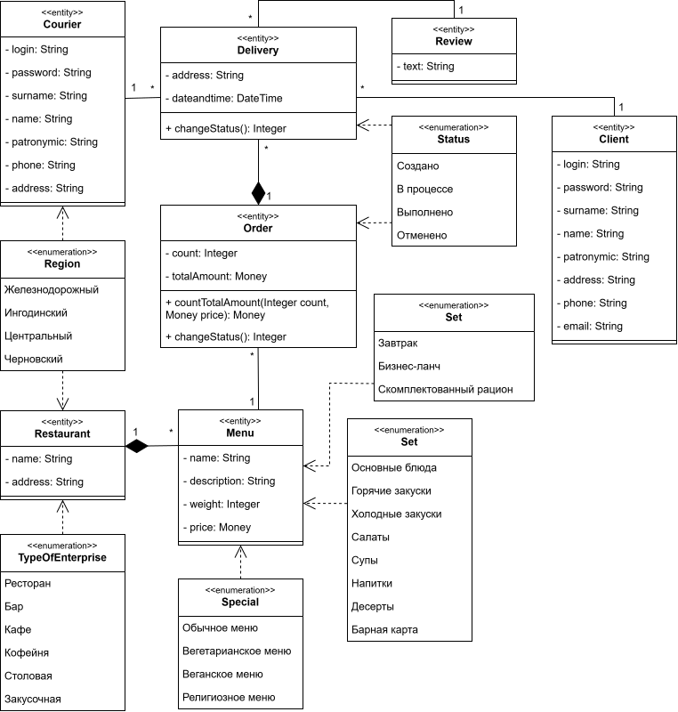

Диаграмма классов интерфейса предназначена для того, чтобы показать структуру непосредственно самой системы.

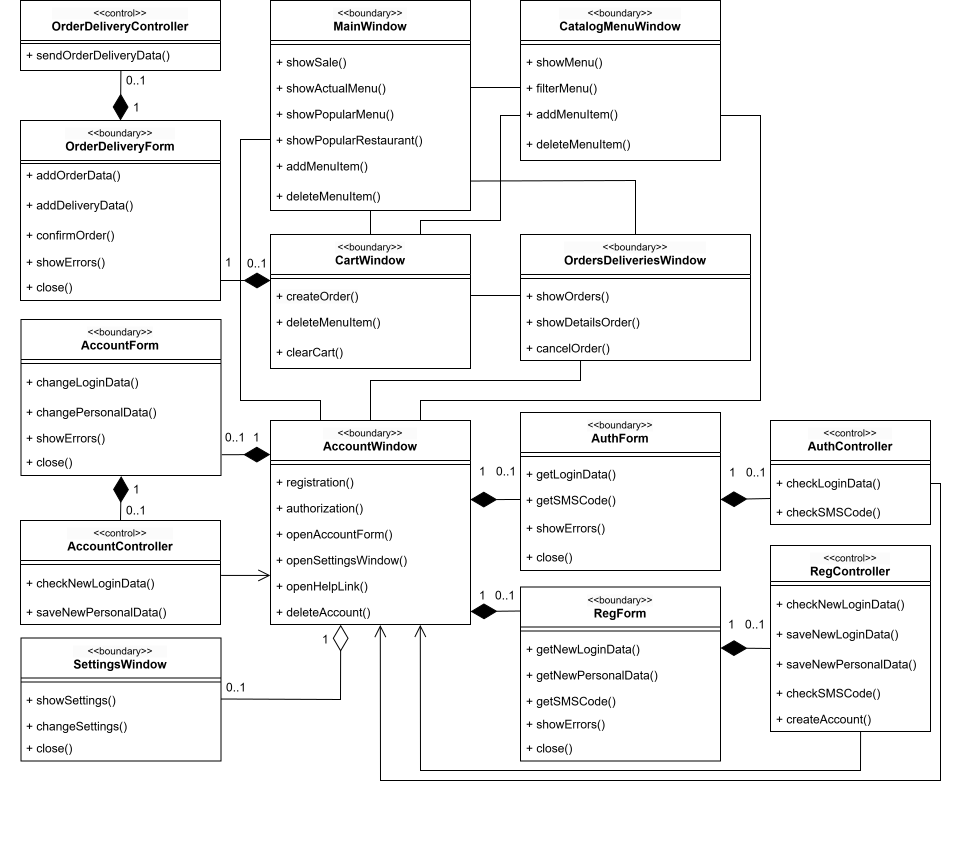

 Диаграмма классов модуля показывает статическую структуру модуля, отображая его составные элементы и связи между ними.

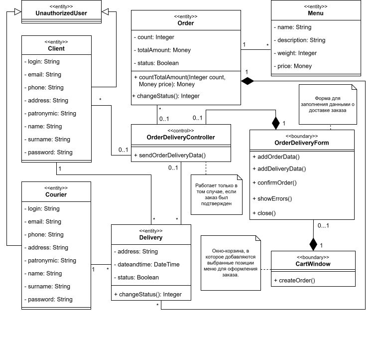

### Диаграмма последовательности

Данная диаграмма отражает, как объекты взаимодействуют друг с другом в рамках определенного сценария или прецедента.

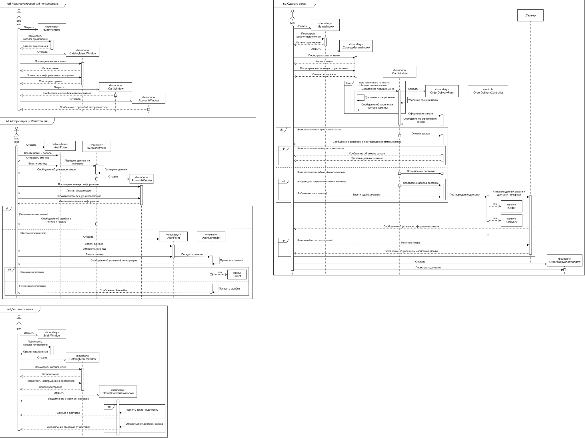

### Диаграмма деятельности

Данная диаграмма позволяет наглядно представить последовательность действий, необходимых для выполнения бизнес-процессов.

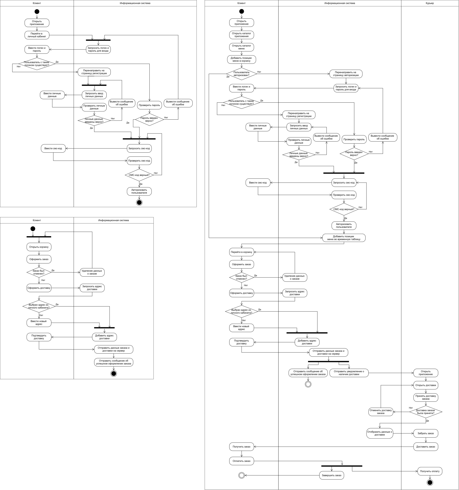

### Диаграмма коммуникаций

Данная диаграмма показывает взаимодействие между объектами или ролями в виде графа, где акцент делается на структурных связях и порядке передачи сообщений.

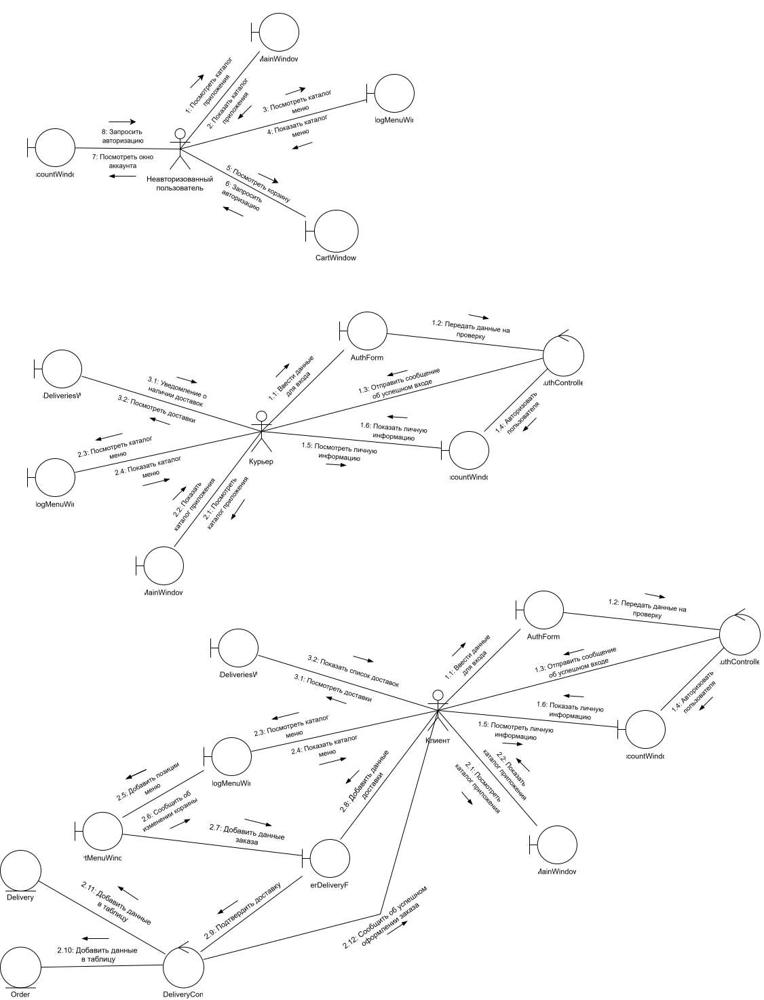

## Разработка логической модели данных

Логическая модель данных – это абстрактное представление структуры данных.

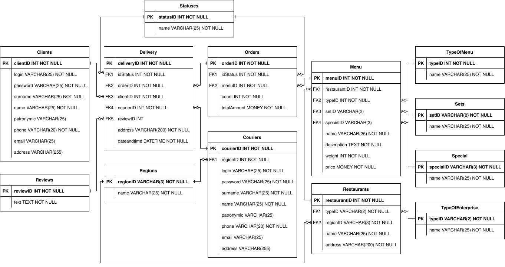
