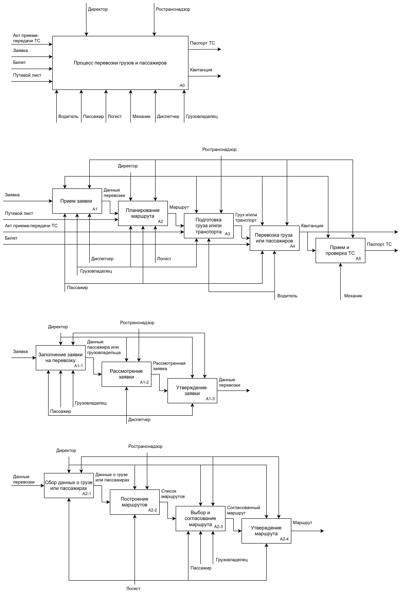
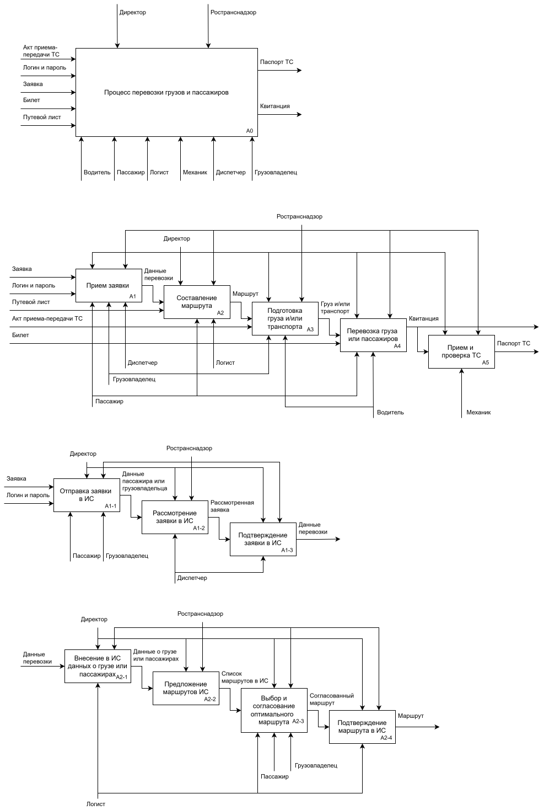
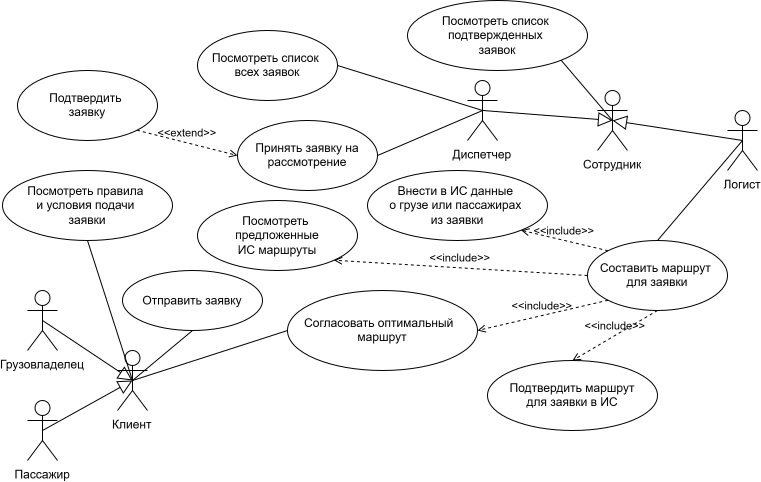
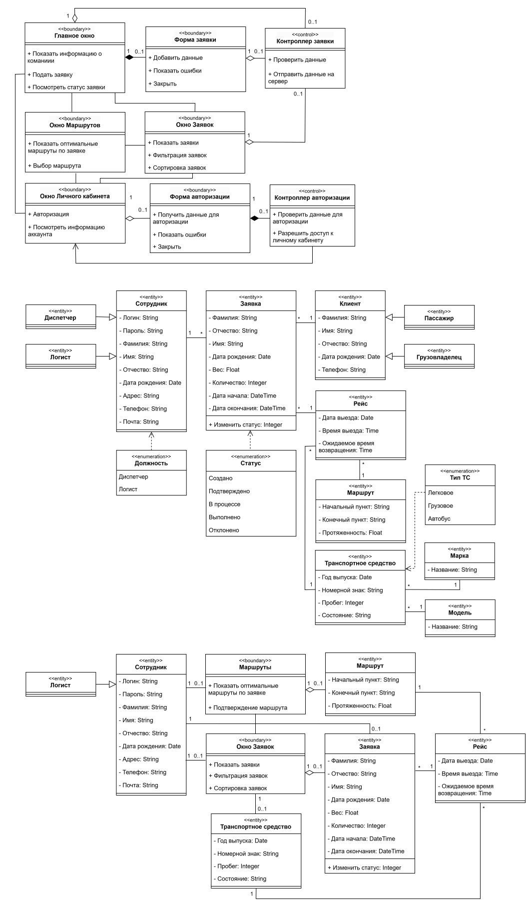
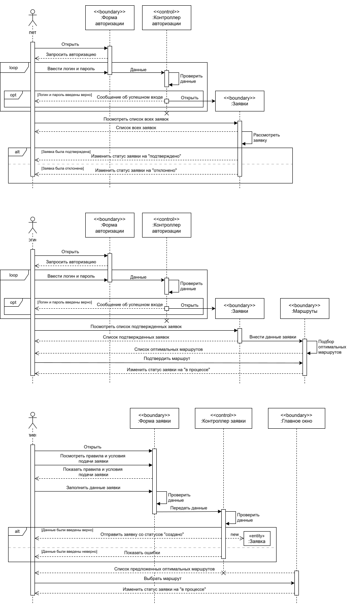
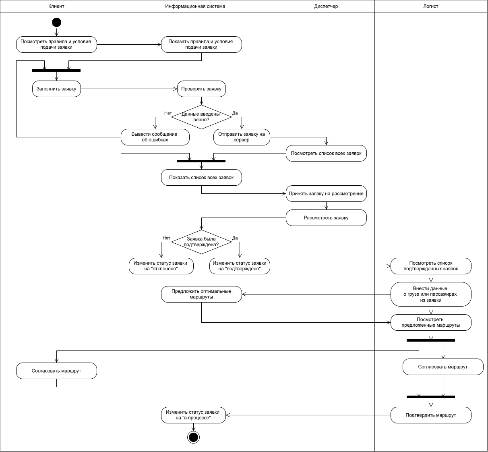
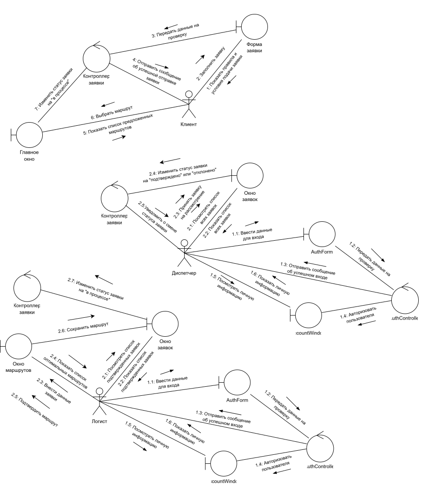

# Проектирование информационной системы для службы перевозки грузов и пассажиров

В данном кейсе представлены анализ и моделирование бизнес-процессов службы перевозки грузов и пассажиров. 
Проектирование выполнено с использованием следующих **методологий** и **нотаций**:

$`\color{yellow}*`$ `IDEF0` 
$`\color{yellow}*`$ `UML` 

**Объект проектирования** – деятельность службы перевозки грузов и пассажиров.

## Разработка концептуальной модели

Концептуальная модель – это описание предметной области, которое построено в процессе ее анализа и выполнено с использованием естественного языка, математических выражений, таблиц, графов и других средств.

### Диаграмма AS-IS 

Это модель для описания бизнес-процессов в организации, с помощью которой отражается и визуализируется, как организованы процессы в данный момент, без использования информационной системы.

**Структура диаграммы:**

$`\color{yellow}*`$ **Входные документы:** акт приема-передачи ТС, заявка, билет, путевой лист; 
$`\color{yellow}*`$ **Выходные документы:** паспорт ТС, квитанция; 
$`\color{yellow}*`$ **Управляющие регламенты:** директор, Ространснадзор; 
$`\color{yellow}*`$ **Исполнители:** водитель, пассажир, механик, логист, диспетчер, грузовладелец. 

### Диаграмма TO-BE 

Это модель для описания бизнес-процессов в организации, с помощью которой отражается и визуализируется, как будут организованы процессы в будущем, после создания и внедрения информационной системы.

**Структура диаграммы:**

$`\color{yellow}*`$ **Входные документы:** логин и пароль, акт приема-передачи ТС, заявка, билет, путевой лист; 
$`\color{yellow}*`$ **Выходные документы:** паспорт ТС, квитанция; 
$`\color{yellow}*`$ **Управляющие регламенты:** директор, Ространснадзор; 
$`\color{yellow}*`$ **Исполнители:** водитель, пассажир, механик, логист, диспетчер, грузовладелец. 

## Разработка логической модели

Логическая модель информационной системы – это совокупность описания ее объектов и связей между ними.

### Диаграмма прецедентов

Данная диаграмма позволяет описать функциональные возможности системы и показать, какие действия могут выполнять пользователи и какие результаты они могут получать.

### Диаграмма классов

Диаграмма классов базы данных используется для того, чтобы показать структуру данных, состоит из классов, их атрибутов, методов и связей между ними. Диаграмма классов интерфейса предназначена для того, чтобы показать структуру непосредственно самой системы. Диаграмма классов модуля показывает статическую структуру модуля, отображая его составные элементы и связи между ними.

### Диаграмма последовательности

Данная диаграмма отражает, как объекты взаимодействуют друг с другом в рамках определенного сценария или прецедента.

### Диаграмма деятельности

Данная диаграмма позволяет наглядно представить последовательность действий, необходимых для выполнения бизнес-процессов.

### Диаграмма коммуникаций

Данная диаграмма показывает взаимодействие между объектами или ролями в виде графа, где акцент делается на структурных связях и порядке передачи сообщений.

