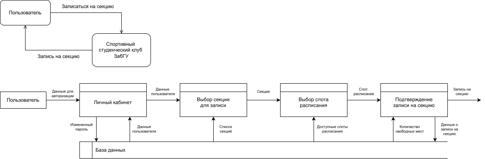
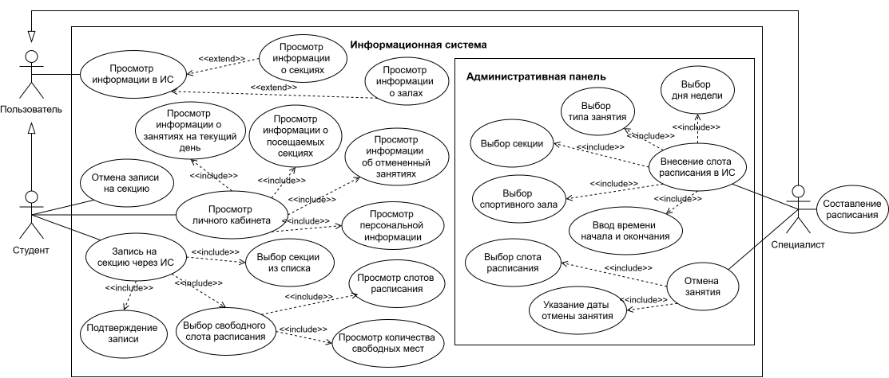
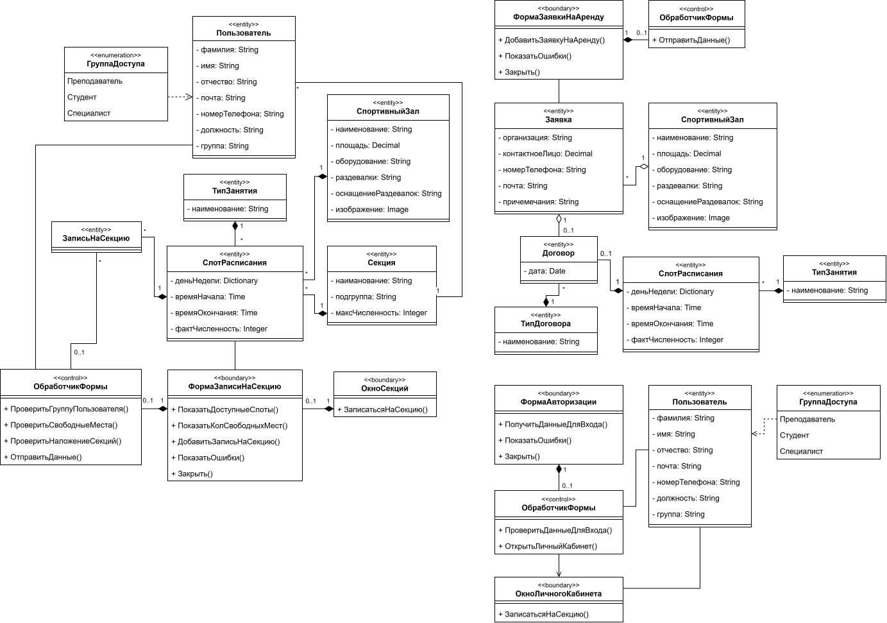
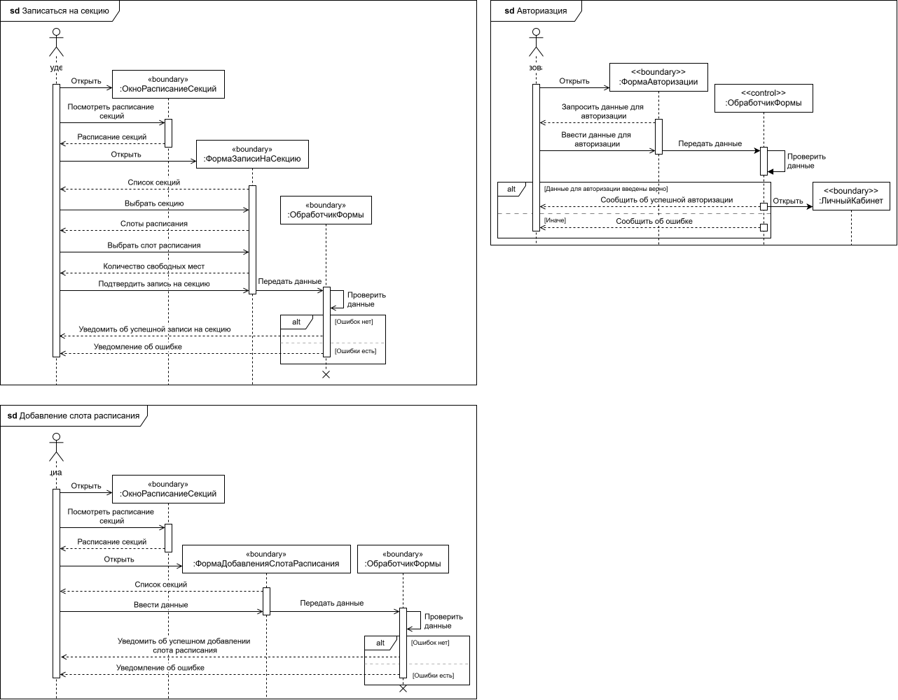
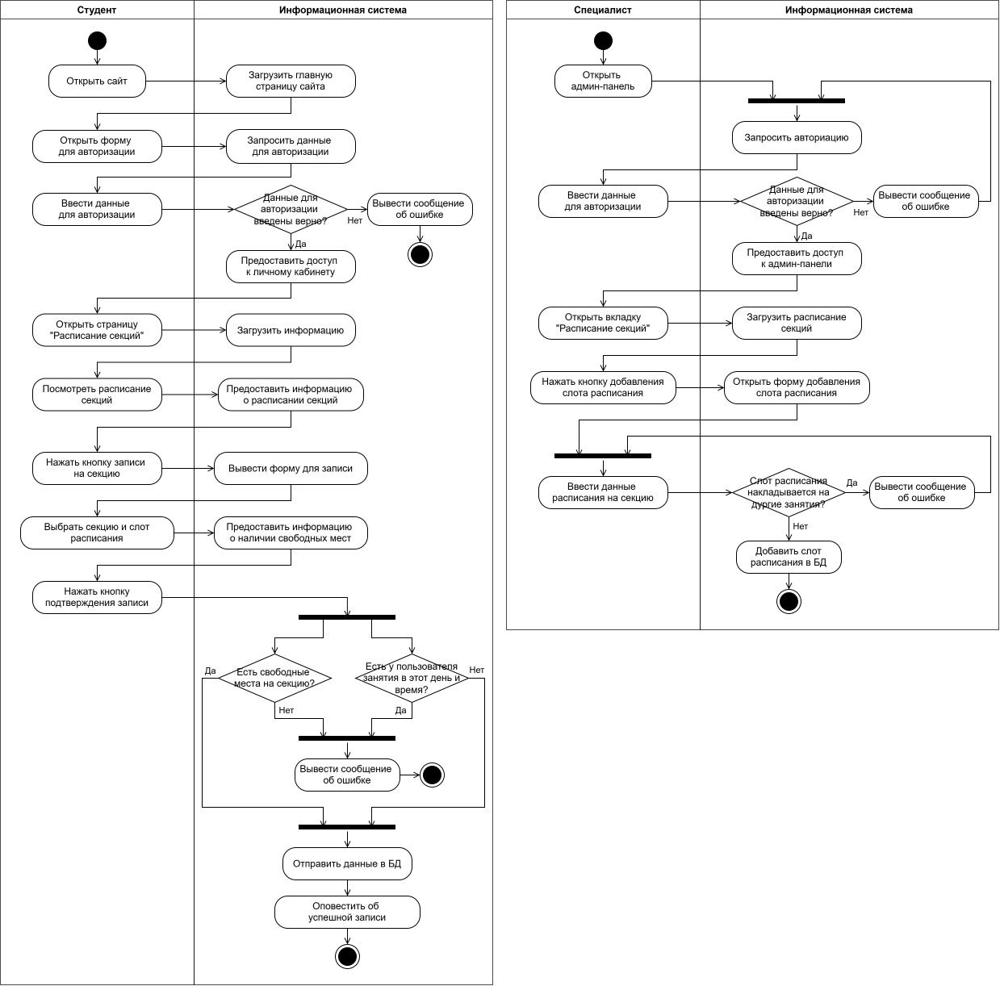
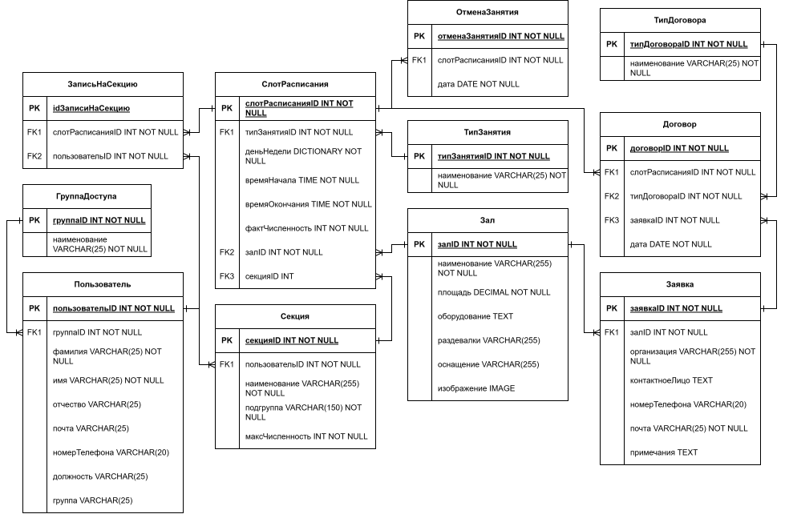

# Проектирование информационной системы для спортивного клуба

В данном кейсе представлены анализ и моделирование бизнес-процессов деятельности спортивного клуба. 
Проектирование выполнено с использованием следующих **методологий** и **нотаций**:

$`\color{yellow}*`$ `BPMN` 
$`\color{yellow}*`$ `UML` 
$`\color{yellow}*`$ `IDEF1X` 
$`\color{yellow}*`$ `DFD`

**Объект проектирования** – студенческий спортивный клуб. 

**Его главные цели:** развитие массового студенческого спорта, продвижение здорового образа жизни и координирование участия сборных команд вуза в соревнованиях различного уровня.

**Основные направления деятельности спортивного клуба:**

$`\color{yellow}*`$ Организация и проведение спортивных мероприятий; 
$`\color{yellow}*`$ Развитие студенческого спорта; 
$`\color{yellow}*`$ Поддержка студенческих сборных команд; 
$`\color{yellow}*`$ Составление расписания учебных и элективных занятий физической культурой, спортивных секций.

## Разработка концептуальной модели

Концептуальная модель – это описание предметной области, которое построено в процессе ее анализа и выполнено с использованием естественного языка, математических выражений, таблиц, графов и других средств.

### Диаграмма AS-IS 

Это модель для описания бизнес-процессов в организации, с помощью которой отражается и визуализируется, как организованы процессы в данный момент, без использования информационной системы.

На изображении представлен процесс "Организация работы секций". 

   
  <em>Процесс "Организация работы секций"</em>

Процесс записи на спортивную секцию осуществляется с помощью бумажного журнала преподавателя, который он оформляет и ведет самостоятельно на протяжении всего семестра. Также в этом журнале есть возможность дополнительно фиксировать посещаемость студентов.

На изображении представлен подпроцесс "Составление расписания". 

   
  <em>Подроцесс "Составление расписания"</em>

Составление расписания осуществляется с помощью Microsoft Excel. В электронную таблицу вносятся секции, разбитые по дням недели и временным ячейкам. После заполнения данная таблица отправляется руководителям секций для ознакомления, проверки и утверждения. Далее расписание публикуется на сайте университета в виде pdf-документа и печатается для развешивания на информационных стендах спортивных площадок. 

Помимо этого электронная таблица с расписанием секций отправляется представителям сторонних организаций в ответ на их запрос по поводу аренды спортивных помещений для занятия спортом или для своих личных целей.

На изображении представлен подпроцесс "Запись на секцию".

   
  <em>Подроцесс "Запись на секцию"</em>

Если студент хочет записаться на спортивную секцию, то сначала он должен узнать текущее расписание интересующей секции на сайте университета, на учебных информационных стендах или у преподавателей ФОКа. После этого он должен лично прийти на место проведения секции и, если остались свободные места, он сможет записаться на занятие.

### Диаграмма TO-BE 

Это модель для описания бизнес-процессов в организации, с помощью которой отражается и визуализируется, как будут организованы процессы в будущем, после создания и внедрения информационной системы.

На изображении представлен процесс "Организация работы секций".

   
  <em>Процесс "Организация работы секций"</em>

После внедрения информационной системы процесс записи студента на секцию будет происходить удаленно, без непосредственного вмешательства преподавателей. Вход в информационную систему будет осуществляться через интеграцию с университетским личным кабинетом студента, то есть будет использоваться единая точка входа для авторизации пользователя.

На изображении представлен подпроцесс "Составление расписания".

   
  <em>Подроцесс "Составление расписания"</em>

Процесс составления расписания тоже будет выглядеть иначе: специалист клуба должен внести расписание секций в информационную систему, и оно станет доступным на сайте для всех пользователей. Студенту больше не придется тратить время на то, чтобы узнать расписание секций, вся информация уже будет представлена ему в информационной системе.

На изображении представлен подпроцесс "Запись на секцию".

   
  <em>Подроцесс "Запись на секцию"</em>

Перед записью на секцию студент сможет посмотреть с расписанием всех секций, сгруппированных по дням недели. После ему нужно будет только выбрать заинтересовавшую его секцию и свободный слот расписания.

Кроме этого, на сайте студент также сможет ознакомиться со спортивными помещениями (залами) университета, их характеристиками и имеющимся в них оборудованием. Данная информация на данный момент отсутствует на сайте университета, однако, с помощью информационной системы она станет общедоступной не только для студентов, но и жителей города, которые в будущем смогут арендовать спортивные залы для своих нужд.

### Диаграмма DFD

Данная диаграмма показывает, как информация попадает в систему, где обрабатывается, где хранится и куда уходит дальше. 

Чтобы авторизоваться в системе, пользователь должен внести в нее свои данные для авторизации. Когда он находится в личном кабинете, то из базы данных подгружается его личная информация, а в случае смены пароля, новый пароль сохраняется в базе данных. Когда пользователь пытается записаться на секцию, то из базы данных подгружается информация о доступных секциях, свободных слотах для записи и количестве свободных мест. Соответственно, при подтверждении записи новая информация сохраняется в базу данных.

## Разработка логической модели

Логическая модель информационной системы – это совокупность описания ее объектов и связей между ними.

### Диаграмма прецедентов

Данная диаграмма позволяет описать функциональные возможности системы и показать, какие действия могут выполнять пользователи и какие результаты они могут получать.

В разрабатываемой информационной системе актерами являются студент и специалист клуба, которые в свою очередь наследуются от общего пользователя.

Пользователь может просматривать информацию в системе, в том числе информацию о секциях и спортивных залах. Студент может записываться на секции, прослеживать свою активность в личном кабинете и отменять записи на занятия. Специалист в административной панели может создавать новые слоты расписания секций и отменять занятия на определенные даты.

### Диаграмма классов

Диаграмма классов базы данных используется для того, чтобы показать структуру данных, состоит из классов, их атрибутов, методов и связей между ними. Диаграмма классов интерфейса предназначена для того, чтобы показать структуру непосредственно самой системы. 

На основе технико-экономической характеристики предметной области, а также сформированных требований к информационной системе, информационная система была разделена на следующие программные модули: "Расписание", "Аренда" и "Пользователи".

Модуль "Расписание" предназначен для управления расписанием спортивных секций. Модуль "Аренда" предназначен для управления заявками на аренду спортивных помещений от сторонних организаций. Модуль "Пользователи" предназначен для управления аккаунтами пользователей информационной системы.

### Диаграмма последовательности

Данная диаграмма отражает, как объекты взаимодействуют друг с другом в рамках определенного сценария или прецедента.

На диаграмме последовательности для авторизации пользователя видно, что если пользователь введет данные для авторизации верно, то система предоставит ему доступ в личный кабинет, иначе – выдаст сообщение об ошибке. Диаграмма последовательности для специалиста показывает процесс добавления нового слота расписания в административной панели. 

Когда пользователь авторизован в системе и относится к группе "Студенты", он через форму может записаться на спортивную секцию. В процессе система проведет проверку на наличие свободных мест и пересечение с другими занятиями по секциям, на которые пользователь уже записан. Если свободные места есть и пересечений по занятиям нет, то студент успешно будет записан на секцию.

### Диаграмма деятельности

Данная диаграмма позволяет наглядно представить последовательность действий, необходимых для выполнения бизнес-процессов.

Диаграмма деятельности для специалиста клуба демонстрирует процессы авторизации и добавления нового слота расписания. Если добавляемый слот расписания пересекается по времени с уже существующим, то специалисту будет выведено соответствующее сообщение об ошибке.

Диаграмма деятельности для студента университета демонстрирует процессы авторизации и записи на секцию. Если происходит пересечение записи на секцию с занятиями, которые студент уже посещает, или отсутствуют свободные места, то будет выведено соответствующее предупреждение.

## Разработка логической модели данных

Логическая модель данных – это абстрактное представление структуры данных.

