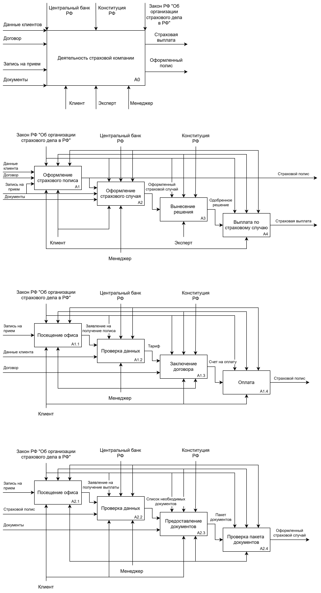
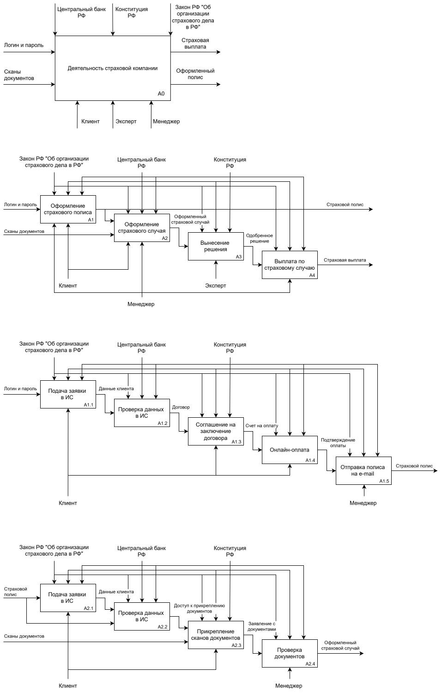
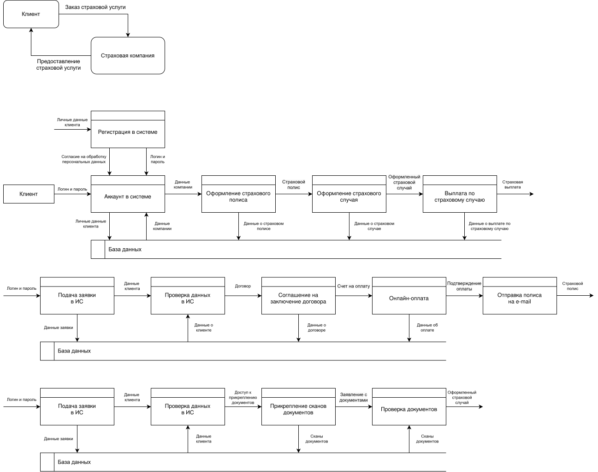

# Проектирование и моделирование бизнес-процессов страховой компании

В данном кейсе представлены анализ и моделирование бизнес-процессов страховой компании. Проектирование выполнено с использованием методологии функционального моделирования IDEF0 и графического инструмента моделирования DFD.

**Объект проектирования** – деятельность страховой компании. 

## Диаграмма AS-IS 

Деятельность страховой компании без использования проектируемой информационной системы.

$`\color{yellow}*`$ **Входные документы:** данные клиентов, договор, запись на прием, документы; 
$`\color{yellow}*`$ **Управляющие регламенты:** центральный банк РФ, конституция РФ, закон РФ "Об организации страхового дела в РФ"; 
$`\color{yellow}*`$ **Исполнители:** клиент, эксперт, менеджер; 
$`\color{yellow}*`$ **Выходные документы:** страховая выплата, оформленный полис. 

## Диаграмма TO-BE 

В рамках диаграммы TO-BE была спроектирована логика работы процессов страховой компании после внедрения информационной системы.

$`\color{yellow}*`$ **Входные документы:** логин и пароль, сканы документов; 
$`\color{yellow}*`$ **Управляющие регламенты:** центральный банк РФ, конституция РФ, закон РФ "Об организации страхового дела в РФ"; 
$`\color{yellow}*`$ **Исполнители:** клиент, эксперт, менеджер; 
$`\color{yellow}*`$ **Выходные документы:** страховая выплата, оформленный полис. 

## Диаграмма DFD

На диаграмме продемонстрировано, как информация движется через систему: откуда она приходит, где обрабатывается, где хранится и куда передается. 

